# qRaf

**Which project is on which drive, at a glance.**
QR-coded inventory for production hard drives, with role-based access.

[English](#english) · [Türkçe](#türkçe)

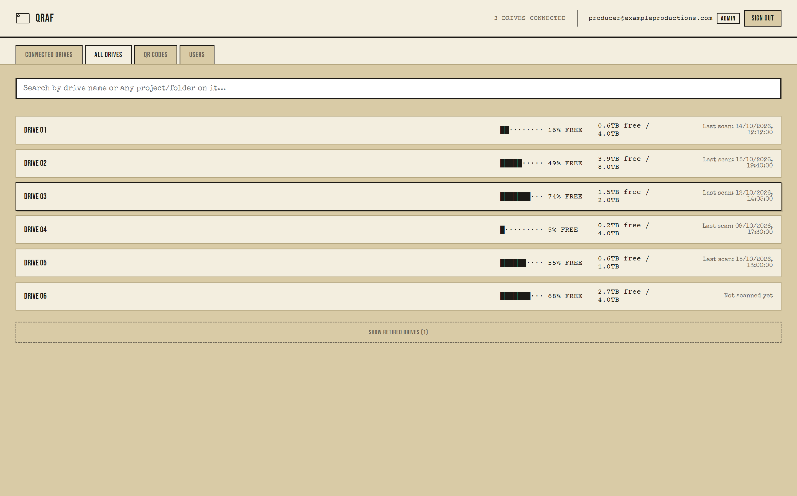

---

## English

qRaf keeps track of the external drives where production companies and content creators keep
their footage. Type the project or folder you are looking for and see which drive it is on.
Each drive gets a QR label. When a drive is plugged in, the desktop app scans it and records
its folders, sizes and free space, and measures its read/write speed. Anyone on the team can
scan the label with their phone and see what is on the drive without plugging it in. Looking
for an empty drive? qRaf shows which one has room, without plugging them in one by one.

It replaces the hand-maintained spreadsheet of drives and fixes that spreadsheet's two
problems: updates get skipped, and a project spelled two different ways can't be found. In
qRaf the list updates itself every time a drive is connected, and search covers drive names
and every folder name.

### Features

- **Connected drives:** external drives are detected and scanned automatically. While a drive
  stays connected it is rescanned every hour, or on demand with *Scan now*.
- **All drives:** every registered drive in one list, including the ones on the shelf, with a
  free-space meter, last scan date and read/write speed.
- **Folder search:** answer "which drive is this project on?" from a single box. Search covers
  subfolders four levels deep and ignores case and diacritics. The result opens with the
  matching folder highlighted.
- **QR labels with your brand:** a unique QR value for every drive. Labels are exported to PDF
  in one go for printing, with your own logo on them.
- **Scan from your phone:** the Android app scans a label and shows the drive's folder tree
  and free space.
- **Drive speed:** read/write speed is measured once each time a drive is connected. If the
  drive is busy with another transfer, the test waits. A drive that is slowing down gets
  noticed.
- **Retired drives:** lost, broken or shipped drives move to a separate section with a note
  and stay out of the main list.
- **Roles:** *Admin* registers, renames and retires drives and manages users. *User* can only
  view. Accounts are invite-only, and uninvited sign-ups are rejected by the database itself.
- **Offline:** scans taken without a connection are queued and sent when it comes back.

<table>
<tr><td>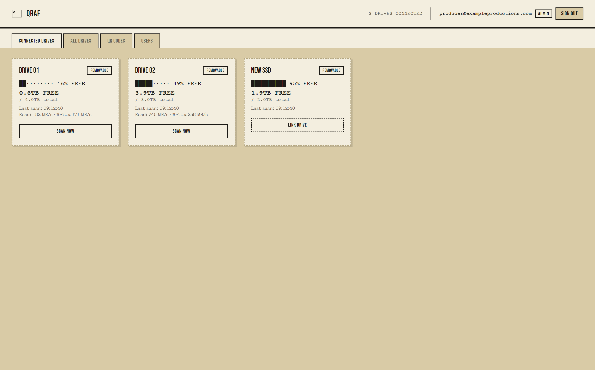</td><td>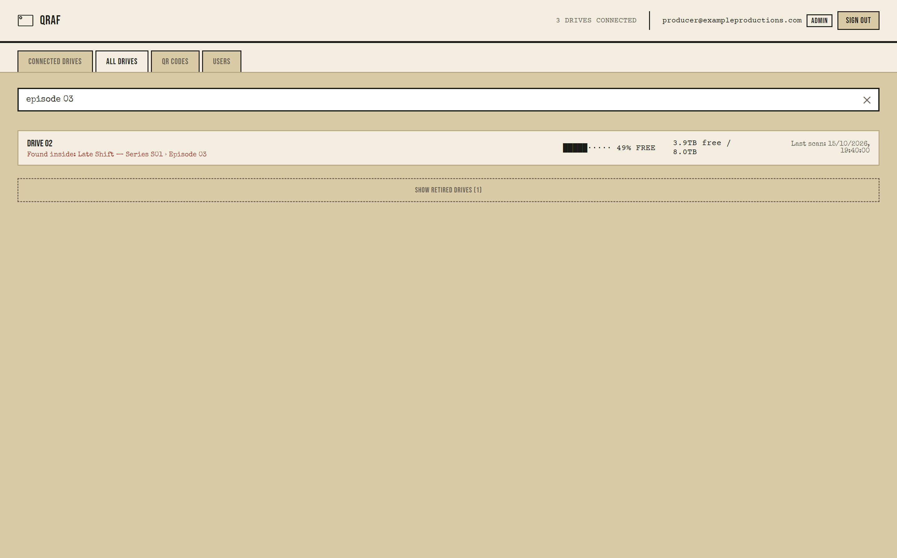</td></tr>
<tr><td>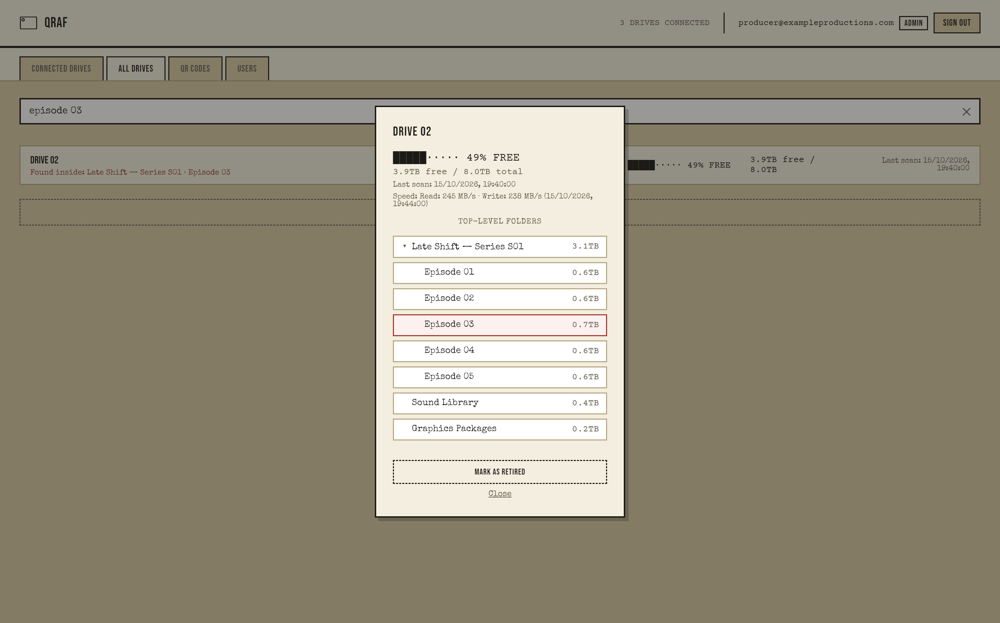</td><td>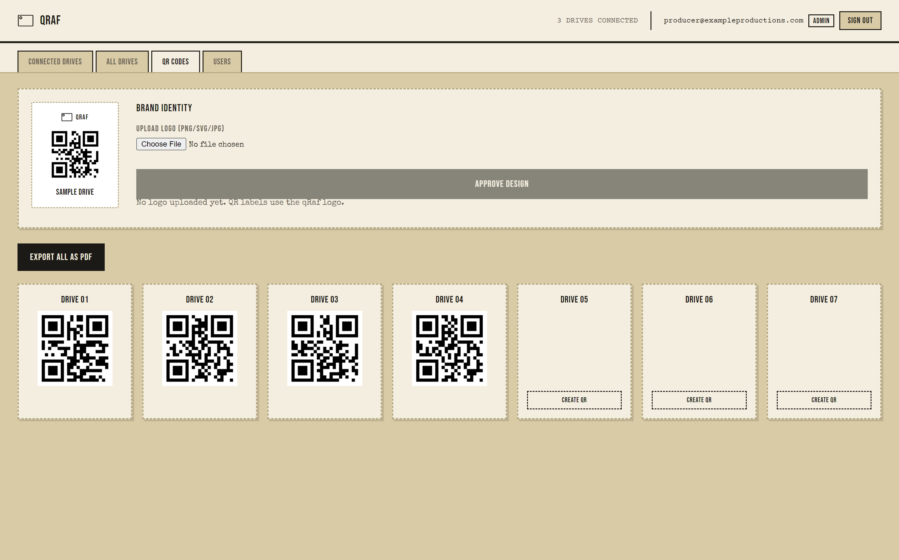</td></tr>
<tr><td>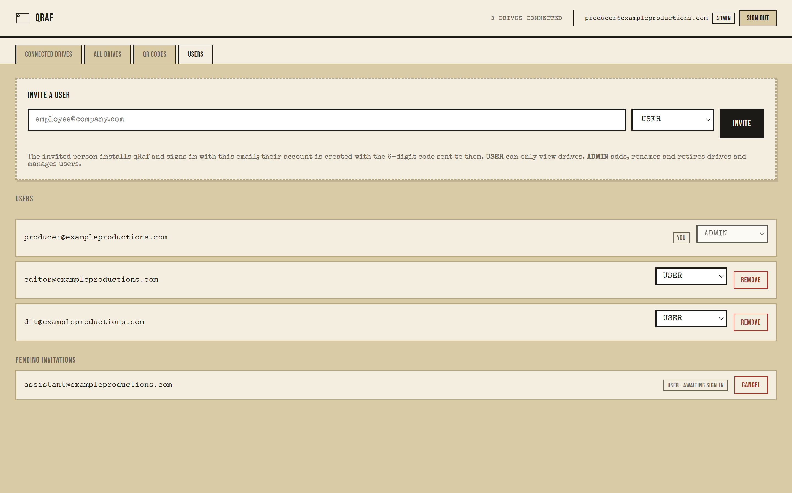</td><td>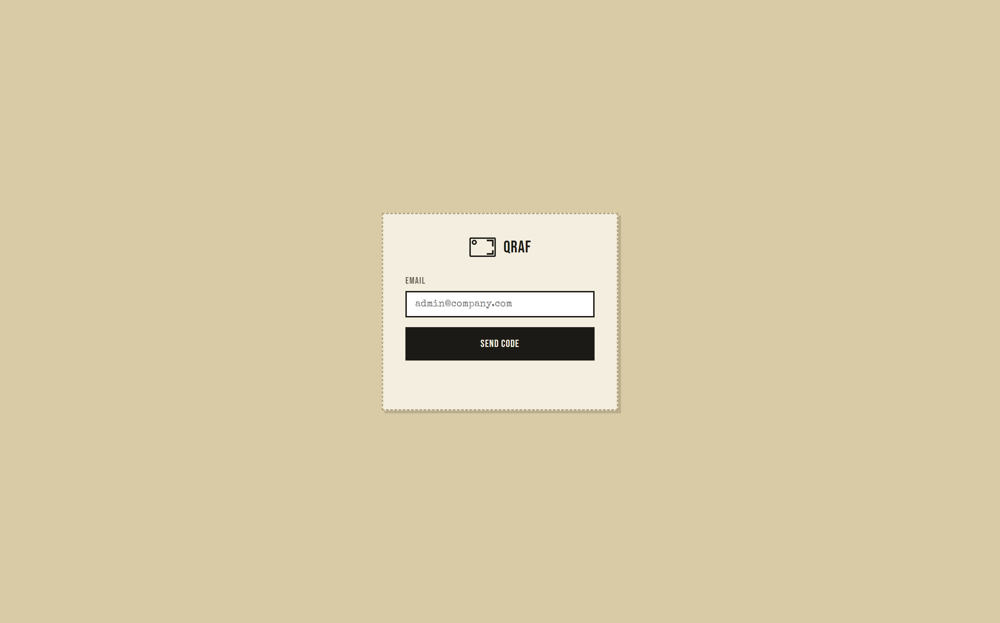</td></tr>
</table>

<table>
<tr>
<td>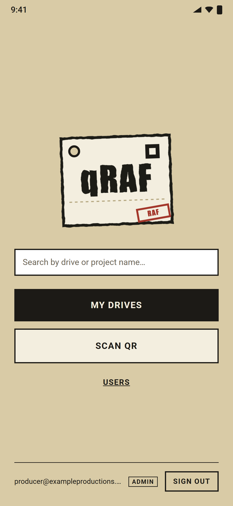</td>
<td>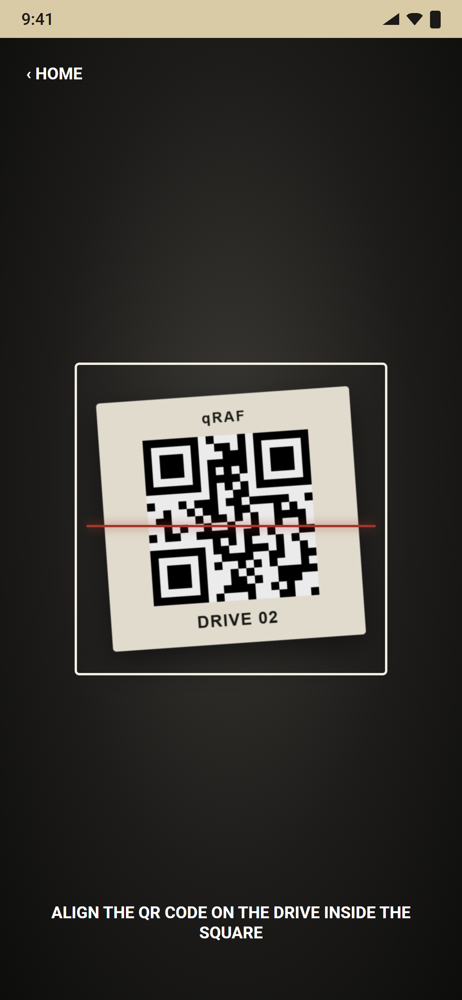</td>
<td>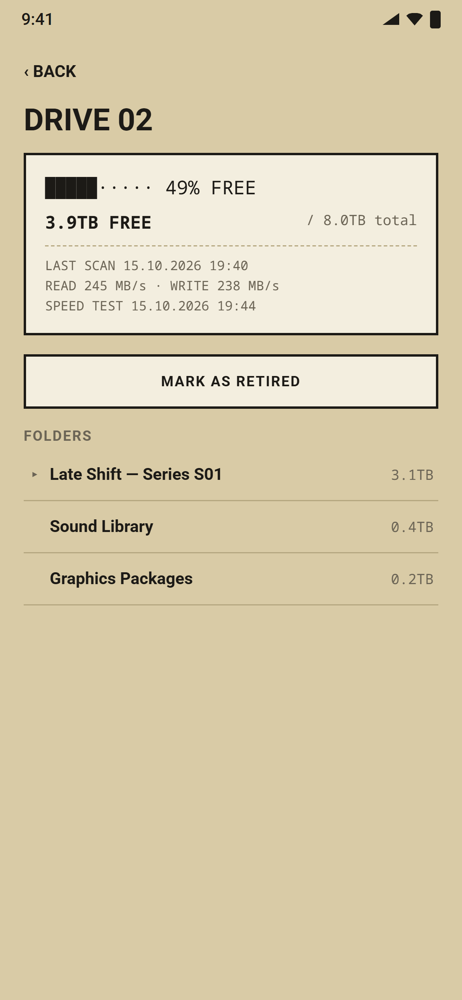</td>
<td>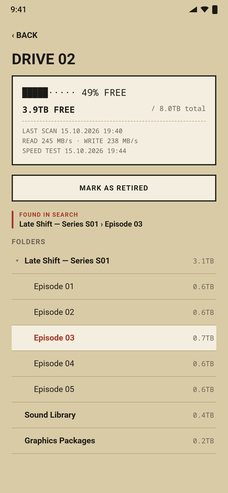</td>
</tr>
</table>

*Company, drive and project names in the screenshots are fictional. Android screens are
rendered from the app's code in a browser with sample data.*

### Platforms

| | Status |
|---|---|
| Desktop, macOS | In use |
| Desktop, Windows | In use |
| Android | In use (APK, installed outside the Play Store) |
| iOS | Not available yet |

Sign-in is passwordless: a 6-digit code is sent to your email.

### How it works

Your data lives in a [Supabase](https://supabase.com) project that you create (the free plan is
enough). Nothing is sent to us or anyone else. A QR label carries only the drive's ID, never
its contents. Someone who scans a label sees nothing unless they are signed in and authorized;
access is enforced in the database with row-level security (RLS).

qRaf never reads, copies or uploads the files on your drives. It records folder names and
sizes, capacity, free space and speed measurements.

### Setup

You need Node.js 22+ and a Supabase account. For the Android app, also JDK 17 and the Android
SDK.

**1. Supabase project.** Create a new project at [supabase.com](https://supabase.com).

**2. Database.** Apply the migrations in order:

```bash
cd backend
npx supabase login
npx supabase link --project-ref <your-project-ref>
npx supabase db push
```

(If you'd rather not use the CLI, run the files in `backend/supabase/migrations/` in name
order in the Supabase SQL Editor.)

**3. Your company and the first admin.** In the SQL Editor, with your own details:

```sql
update public.organizations set name = 'Your Company';

insert into public.invitations (email, role, org_id)
select 'you@yourcompany.com', 'admin', id from public.organizations;
```

Write the email in lowercase. This address creates the admin account on first sign-in; you
invite everyone else from the app's *Users* tab.

**4. Sign-in email.** In the Supabase dashboard:

- *Authentication → Providers → Email:* set **Email OTP Length** to **6** and **Email OTP
  Expiration** to **600** seconds (a short window leaves less time to guess a code). Keep new user
  sign-ups enabled; the database already rejects anyone without an invitation. Keep
  **Confirm email** on as well. qRaf only signs in with the emailed code: the database grants
  no access to a session opened with a password or to an unconfirmed email address, so a
  stranger who registers a pending invitation's address with a password gets nothing.
- *Authentication → Emails → SMTP Settings:* connect your own mail server. Supabase's
  built-in sender is limited to a few emails per hour, and templates can only be edited with
  custom SMTP.
- *Authentication → Emails → Templates:* in **Magic Link** and **Confirm signup**, replace the
  link with the code, for example: `<p>Your qRaf sign-in code: <b>{{ .Token }}</b></p>`

**5. Point the apps at your project.** Copy the Project URL and the publishable key from
*Project Settings → API* into two files:

- `desktop/renderer/config.js`
- `mobile/src/config.ts`

The publishable key is designed to ship inside apps; database policies protect the data.
**Never put the secret key in any file.**

**6. Desktop app.**

```bash
cd desktop
npm install
npm start            # development
npm run dist:mac     # macOS .dmg
npm run dist:win     # Windows installer
```

The build hardens the Electron runtime (fuses: no `ELECTRON_RUN_AS_NODE`, no `NODE_OPTIONS`
or `--inspect`, app loaded only from its integrity-checked archive). The installers it
produces are unsigned; before you distribute them to other computers, sign them with your
own code-signing certificate (Apple Developer ID on macOS, Authenticode on Windows) so users
can tell a genuine copy from a tampered one.

**7. Android app.**

```bash
cd mobile
npm install
npx react-native run-android                    # to a connected phone or emulator
cd android && ./gradlew assembleRelease         # APK: app/build/outputs/apk/release/
```

Before you distribute the APK, create your own signing key. The configuration in this
repository signs with React Native's default debug key
([how to](https://reactnative.dev/docs/signed-apk-android)).

**Tip:** free Supabase projects are paused after a week without any requests. If your drives
won't be connected for a while, opening the app now and then is enough.

### Tests

```bash
cd backend/tests && npm install && npm test   # migrations + role/invitation rules (PGlite, never touches your live database)
cd mobile && npm test                          # mobile screen and helper tests
```

### License

[GNU AGPL-3.0](LICENSE). A Sceneva Labs project.

---

## Türkçe

qRaf, yapım şirketlerinin ve içerik üreticilerinin görüntülerini sakladığı harici diskleri
takip eder. Aradığın projeyi ya da klasörü yazarsın, hangi diskte olduğu önüne gelir. Her
diske bir QR etiket yapıştırılır. Disk bilgisayara takılınca masaüstü uygulaması diski tarar;
klasörleri, boyutları ve boş alanı kaydeder, okuma/yazma hızını ölçer. Telefondan etiketi
okutan ekip üyesi, diski takmadan içinde ne olduğunu görür. Boş disk mi arıyorsun? Raftaki
diskleri tek tek takmadan hangisinde yer olduğunu qRaf'tan görürsün.

Excel'de elle tutulan disk listesinin iki derdi için yapıldı: güncellemeyi unutmak ve aynı
projenin farklı yazılması yüzünden aramada bulunamaması. qRaf'ta liste, disk her takıldığında
kendiliğinden güncellenir; arama hem disk adlarında hem bütün klasör adlarında yapılır.

**Ne yapar:** takılan diski otomatik tarar (takılı kaldıkça saat başı); rafta duranlar dahil
bütün diskleri boş alan, son tarama ve hızla tek listede gösterir; "bu proje hangi diskte?"
sorusunu dört seviye alt klasöre kadar tek kutudan yanıtlar; her disk için QR etiket üretir,
toplu PDF'e aktarır, etiketlere kendi logonu koyabilirsin; Android uygulaması etiketi okutunca klasör
ağacını gösterir; her takılışta okuma/yazma hızını ölçer; kayıp/arızalı diskleri ayrı bölüme
alır. **Admin** disk ekler, adlandırır, kullanılmayan olarak işaretler ve kullanıcıları
yönetir; **Kullanıcı** yalnızca görüntüler. Hesaplar davetle açılır.

**Platformlar:** macOS ve Windows masaüstü, Android (kullanımda). iOS henüz yok. Arayüz
İngilizce. Giriş, e-postaya gelen 6 haneli kodla yapılır.

**Veriler nerede:** senin açtığın Supabase projesinde (ücretsiz plan yeterli). Bize ya da
başka birine veri gönderilmez. QR etiket yalnızca diskin kimliğini taşır; yetkisi olmayan
okutsa da bir şey göremez. qRaf disklerdeki dosyaları okumaz, kopyalamaz, yüklemez; klasör
adlarını, boyutları, boş alanı ve hız ölçümünü kaydeder.

**Kurulum:** yukarıdaki *Setup* adımlarını sırayla izle: Supabase projesi aç, migration'ları
uygula, SQL Editor'de şirket adını yaz ve ilk admini davet et, e-posta ayarlarını yap (OTP 6
hane ve 600 sn geçerlilik, özel SMTP, şablonlarda `{{ .Token }}`, **Confirm email** açık), URL ve publishable anahtarı iki config dosyasına
yaz, masaüstü ve Android uygulamasını derle. Secret anahtarı hiçbir dosyaya yazma.

**Lisans:** [GNU AGPL-3.0](LICENSE). Bir Sceneva Labs projesi.
